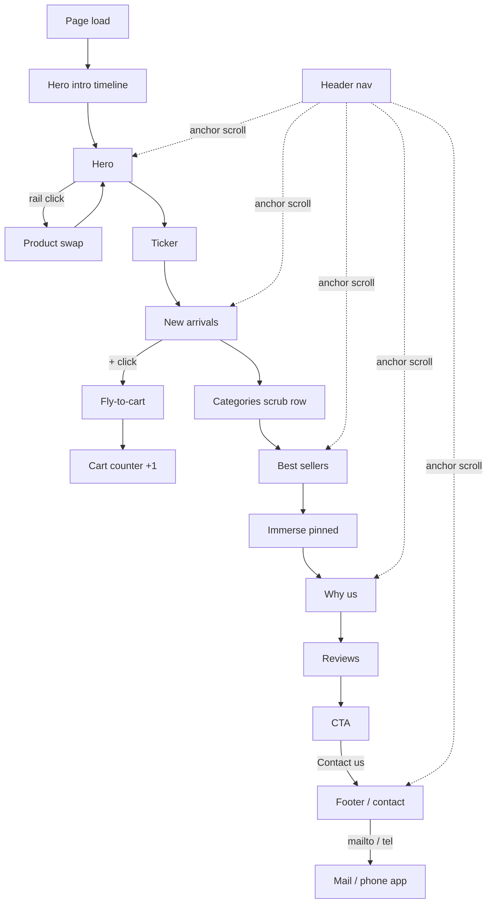

# 3. App Flow Document — KVIST

## 1. Overview
This doc maps what happens when someone clicks and which section comes next. KVIST is one page. "Navigation" means smooth-scrolling between sections, plus a few in-place interactions (hero rail, add to cart, burger menu). §6 holds the **DOM & class contract**. Markup, CSS and JS must all follow it exactly, because they are built in parallel.

## 2. Pages & Screens
| Page / Section | Route / Anchor | Purpose | Auth required? |
|---|---|---|---|
| Header | (fixed) | Brand, nav, cart | No |
| Hero | `/#top` | First impression, featured products | No |
| Ticker | — | Brand promises marquee | No |
| New arrivals | `/#arrivals` | 4 newest products, add to cart | No |
| Categories | `/#categories` | 9 category chips | No |
| Best sellers | `/#best` | 3 hero products | No |
| Immerse | — | Pinned brand-moment image | No |
| Why us | `/#about` | 4 perks + imagery | No |
| Reviews | `/#reviews` | 3 testimonials | No |
| CTA | `/#cta` | Stylist offer, contact button | No |
| Footer / Contact | `/#contact` | Email, phone, links, wordmark | No |

Nav links (desktop and burger): Home `#top`, Shop `#arrivals`, Best sellers `#best`, About us `#about`, Contact `#contact`.

## 3. Key User Journeys
### Journey: First visit
1. Page loads. `html` gets class `js` (inline script in `<head>`), plus `coarse` if `(pointer: coarse)`.
2. Fonts and the hero image load, then the intro timeline plays (~3.2s). Lenis starts at the end of the intro, so scroll is locked until then (`lenis.stop()` → `lenis.start()`).
3. The user scrolls. Each section reveal fires once, and the parallax effects scrub.

Result: the user sees the whole brand story with motion.

### Journey: Browse hero products
1. The user clicks the "Lamp" thumb in the hero rail (or focuses the rail and presses ArrowDown).
2. The current product drops out, the lamp drops in with a bounce, and the tag updates to "Glød Table Lamp — $240".
3. Clicking another thumb mid-animation queues that index. It plays after the current swap finishes.

Result: the active thumb has `is-on` and `aria-selected="true"`.

### Journey: Add to cart
1. The user clicks "+" on "Stubbe Oak Stool".
2. A clone of the product image flies to the header cart icon (x linear, y `back.in`, scales to 0.1, rotates 28°, fades at the end; ~0.9s).
3. The clone is removed, the cart counter increments with an elastic pop, and the cart icon wiggles. `aria-label` becomes "Cart, 1 item".

Result: the counter shows 1. Nothing persists on reload (by design).

### Journey: Jump via nav
1. The user clicks "Best sellers".
2. Lenis scrolls to `#best` with offset `-var(--nav-h)` over ~1.2s. On mobile the burger menu closes first.

Result: the section is in view, and that nav link gets `is-here`.

### Journey: Contact
1. The user clicks "Contact us" in the CTA, which scrolls to `#contact`.
2. The user clicks the email address, which opens their mail client via `mailto:hello@kvist.home`.

## 4. App Flow Diagram


## 5. States & Edge Cases
| Screen | Empty state | Loading state | Error state |
|---|---|---|---|
| Any image slot | n/a | `.ph` gradient + mono label stays visible, the `` has `opacity:0` and gets class `is-loaded` on `load` (fades in) | `error` event: the img is removed and the placeholder stays. No broken-image icon. |
| Hero intro | — | Title, copy and rail are hidden only while `html.js` is set. Intro starts after `document.fonts.ready` + hero img load, or a 2.5s timeout, whichever comes first | If GSAP throws, a `try/catch` removes `html.js` so all content shows |
| Cart | Counter shows `0`, no `has-items` class | — | — |
| Reduced motion | — | No intro. Everything is visible immediately and counters are set to their final value | — |
| Resize | Width change triggers `ScrollTrigger.refresh()`. Height-only changes (mobile URL bar) are ignored | — | — |
| Hash on load (`/#best`) | — | After `load`, jump to the anchor without animation | — |

## 6. DOM & Class Contract (source of truth for markup, CSS and JS)
BEM-style blocks. Only the hooks listed here are referenced by JS. CSS may add any extra classes.

```
html.js / html.coarse                      — set by inline head script
a.skip[href="#main"]
header.nav[data-nav]
  a.logo  "KVIST"
  nav.nav__links > a[href="#…"] ×5         — active: .is-here
  .nav__tools
    button.icon.search[aria-label="Search"]
    button.icon.cart[data-cart][data-magnetic] > svg + span.cart__n[data-cart-n] "0"
  button.nav__burger[aria-expanded][aria-controls="nav-links"]
main#main
  section.hero#top
    .hero__panel                           — green panel, JS scaleX 0→1 (transform-origin left)
    .hero__copy
      h1.hero__title > span.line "Slow" + span.line "Living"   — JS splits each line into span.ch
      p.hero__sub
      a.btn.btn--light[data-magnetic][href="#arrivals"] "Shop now" + span.btn__arrow
      .proof > .proof__faces (3 .face imgs) + strong > span[data-count="12"] "0" + "K+" + small "Happy homes"
    .hero__stage
      .hero__floor                         — elliptical shadow
      .hero__slot.ph.ph--spot[data-ph="…"] ×5 (first has .is-on) > img
      img.hero__fly                         — copy of slot 0 image used for intro flight
      .hero__tag > span.hero__tag-name + span.hero__tag-price
    .rail[role="tablist"] > button.rail__item[role="tab"][data-name][data-price] ×5 > .ph.ph--thumb > img
  section.ticker[aria-hidden="true"] > .ticker__row > (span text + i "✦") ×5, duplicated ×2 by JS
  section.section#arrivals
    .head > h2[data-lines] > span.line ×2 ; a.btn.btn--dark.btn--sm
    .products > article.product ×4
      .product__media.ph.ph--spot[data-ph] > img
      h3 ; .product__price (strong + optional s) ; .product__stock
      button.product__add[data-add][aria-label="Add … to cart"] "+"
  section.section.cats#categories
    h2.cats__h[data-lines] > span.line
    .cats__viewport > .cats__row > a.cat ×9 > .ph.ph--thumb > img + span label
  section.section.loved#best
    .head > h2[data-lines] ; a.btn
    .loved__grid > article.lcard ×3
      .lcard__mask > .lcard__media.ph[data-ph] > img
      span.lcard__badge ; .lcard__cap > h3 + .product__price
  section.immerse
    .immerse__frame > .immerse__media.ph[data-ph] > img
    .immerse__words > span[data-from="-1"] "Built" ; span[data-from="1"] "for" ; span[data-from="-1"] "slow days"
  section.section.why#about
    .why__copy > h2[data-lines] ; .perks > .perk ×4 (svg icon, h3, p) — .perk::before is the top rule, width = calc(var(--draw,1) * 100%)
    .why__media > .why__big.ph > img ; .why__small.ph > img
  section.section.reviews#reviews
    h2.reviews__h[data-lines]
    .quotes > figure.quote ×3 > .quote__top (span.quote__mark "”") ; blockquote ; figcaption.quote__who (img avatar, strong, small)
  section.cta#cta
    .cta__bg.ph[data-ph] > img
    .cta__card > h2[data-lines] ; p ; a.btn.btn--dark[data-magnetic][href="#contact"]
footer.footer#contact
  .footer__top > .footer__talk (h2 "Let's talk", a.footer__mail, a.footer__tel) ; .footer__links (2 lists) ; .footer__img.ph > img
  .footer__word[aria-hidden="true"] > span "K" "V" "I" "S" "T"
  .footer__bottom > .footer__social (3 links) ; p.footer__legal
```

**State classes set by JS:**
- `.is-on` (rail item, hero slot) — the active product.
- `.is-here` (nav link) — the section currently in view.
- `.is-open` (`.nav`) — the burger menu is open.
- `.has-items` (cart) — the cart has at least one item.
- `.is-loaded` (img) — the image has finished loading.
- `.is-in` (product) — the product card has finished its entrance.
- `pin-h` (html) — pinned/horizontal desktop mode is active.
- `.lenis*` — added by Lenis itself.
