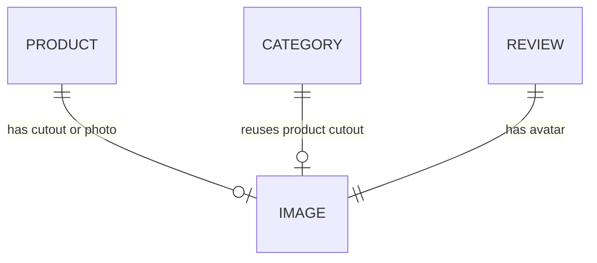

# 5. Backend Schema — KVIST

## 1. Overview
KVIST v1 is a **static site with no database, no auth and no server code**. This doc records that plainly, describes the only "data" (hardcoded content and the in-memory cart counter), and sets out how to grow into a real backend later.

## 2. Data Model
There are no tables. Content is written directly into `index.html`. For reference, this is the implicit shape of each content type:

### product (hardcoded in markup)
| Field | Type | Key / Constraint | Notes |
|---|---|---|---|
| slug | string | unique | used in image filename, e.g. `stool` |
| name | string | required | "Stubbe Oak Stool" |
| price | integer (USD) | required | 220 |
| compare_at | integer | optional | 260, rendered as `<s>` |
| stock | integer | optional | "8 left in stock" (< 10 renders in Error color) |
| badge | string | optional | "Best seller" |

### review (hardcoded)
| Field | Type | Notes |
|---|---|---|
| quote | string | ≤ 200 chars |
| name | string | |
| role_city | string | "Ceramicist, Bergen" |
| avatar | image path | `/images/avatar-1.webp` |

### cart (runtime, in memory)
| Field | Type | Notes |
|---|---|---|
| count | integer | starts at 0, +1 per "+" click, resets on reload |

## 3. Relationships

## 4. Access Control
| Role | Content | Images | Cart counter |
|---|---|---|---|
| Visitor | Read | Read | Own session, in memory only |
| Owner/Dev | Edit via Git | Replace files in `public/images/` | — |

## 5. Data Storage
- **Hosting:** files live in Git and are served from the Vercel CDN, with the Git history acting as the backup.
- **Images:** `public/images/*.webp` (and `.jpg` for `og.jpg`). The filenames are fixed (see `IMAGE-PROMPTS.md`), so swapping an image needs no code change.
- **Retention:** there is no user data, no cookies and no PII. Contact happens through the visitor's own mail client.
- **Future upgrade path:** if a real shop is needed, add Shopify Storefront API or Supabase (`products`, `categories`, `orders` tables) plus Stripe Checkout. This would replace the hardcoded markup with fetched data. Out of scope for v1.
