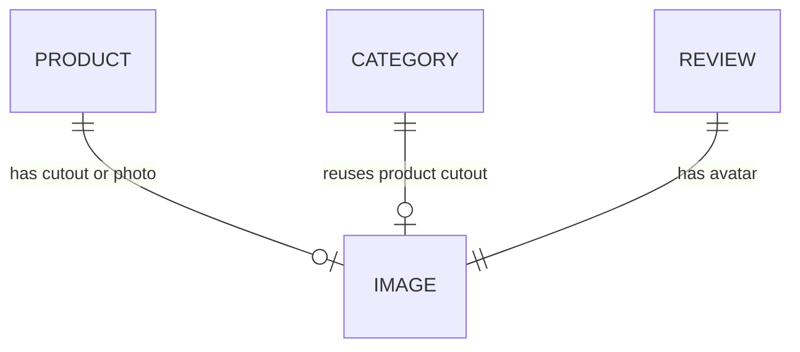

# 5. Backend Schema — KVIST

## 1. Overview
KVIST is a **static site plus one serverless function; no database or auth**. This doc describes the only "data" (hardcoded content, the product catalog, the localStorage cart), the payment API, and how to grow into a real backend later.

## 2. Data Model
There are no tables. Content is written directly into `index.html`. For reference, this is the implicit shape of each content type:

### product (hardcoded in markup)
| Field | Type | Key / Constraint | Notes |
|---|---|---|---|
| slug | string | unique | used in image filename, e.g. `stool` |
| name | string | required | "Stubbe Oak Stool" |
| price | integer (USD) | required | 220 |
| compare_at | integer | optional | 260, rendered as `<s>` |
| stock | integer | optional | "8 left in stock" (< 10 renders in Error color) |
| badge | string | optional | "Best seller" |

### review (hardcoded)
| Field | Type | Notes |
|---|---|---|
| quote | string | ≤ 200 chars |
| name | string | |
| role_city | string | "Ceramicist, Bergen" |
| avatar | image path | `/images/avatar-1.webp` |

### catalog (`src/data/products.js`)
7 products (stubbe-stool, sky-pendant, lin-cushion, skal-bowl, fjell-chair, myk-throw, glod-lamp). Prices are integer cents. Limits: `MAX_QTY = 10` per line, `MAX_LINES = 20`. The server computes amounts from this catalog only.

### cart (localStorage key `kvist-cart`)
| Field | Type | Notes |
|---|---|---|
| (array) | `[{ id, qty }]` | `id` is a catalog id, `qty` is 1..10. Invalid lines are dropped on load. Other tabs sync via the `storage` event. |

### API: `POST /api/create-payment-intent`
Vercel Node function in `api/`. In dev, a Vite plugin in `vite.config.js` serves it.

Request: `{ "items": [{ "id": "stubbe-stool", "qty": 2 }] }`. Client prices are ignored.

| Status | Body | When |
|---|---|---|
| 200 | `{ clientSecret, amount }` | PaymentIntent created |
| 400 | error | bad items or invalid JSON |
| 405 | error | method is not POST |
| 413 | error | body larger than 10 KB |
| 500 | `{ "error": "Payment setup failed" }` | Stripe call failed |
| 503 | error | `STRIPE_SECRET_KEY` missing ("Stripe not configured") or not `sk_test_` ("Sandbox only") |

### Environment variables
| Name | Used by | Notes |
|---|---|---|
| `VITE_STRIPE_PUBLISHABLE_KEY` | browser | must be `pk_test_...` |
| `STRIPE_SECRET_KEY` | API function | must be `sk_test_...`. The live-key guard rejects anything else with 503. |

`.env*` is gitignored except `.env.example`. Test mode only; never commit keys.

## 3. Relationships

## 4. Access Control
| Role | Content | Images | Cart |
|---|---|---|---|
| Visitor | Read | Read | Own browser, in localStorage |
| Owner/Dev | Edit via Git | Replace files in `public/images/` | — |

## 5. Data Storage
- **Hosting:** files live in Git and are served from the Vercel CDN, with the Git history acting as the backup.
- **Images:** `public/images/*.webp` (and `.jpg` for `og.jpg`). The filenames are fixed (see `IMAGE-PROMPTS.md`), so swapping an image needs no code change.
- **Retention:** KVIST servers store no orders and no PII. The cart lives in the visitor's localStorage, and the checkout form values are kept only in sessionStorage for the session. Name, email and shipping address are sent to Stripe (test mode) with the PaymentIntent, along with the payment data. Contact happens through the visitor's own mail client.
- **Build and preview:** `VITE_STRIPE_PUBLISHABLE_KEY` is inlined at build time, so changing it on Vercel needs a redeploy. `vite preview` does not serve `/api`; use `npm run dev` or Vercel.
- **Future upgrade path:** if a real shop is needed, add Shopify Storefront API or Supabase (`products`, `categories`, `orders` tables) and move from Stripe test mode to live, with webhooks for order storage. This would replace the hardcoded markup with fetched data. Out of scope for v1.
